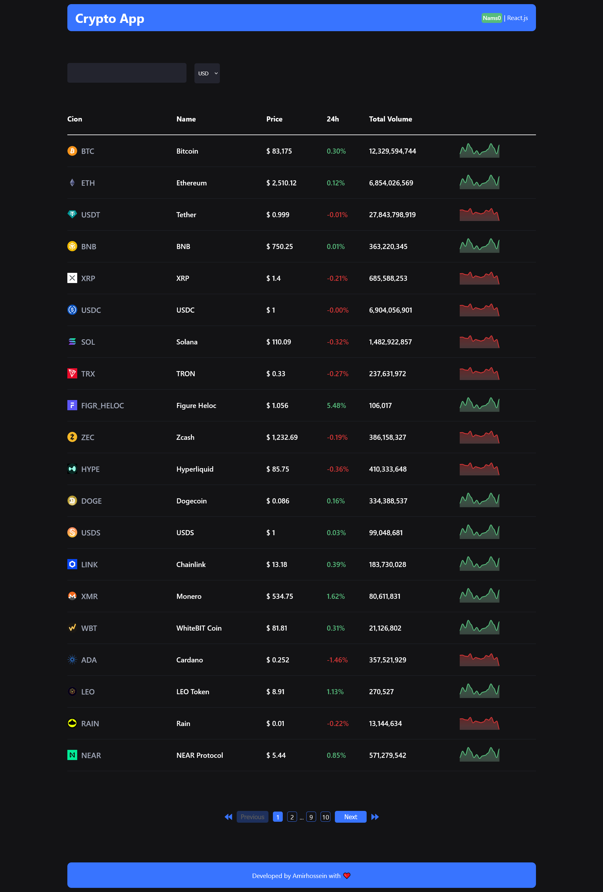
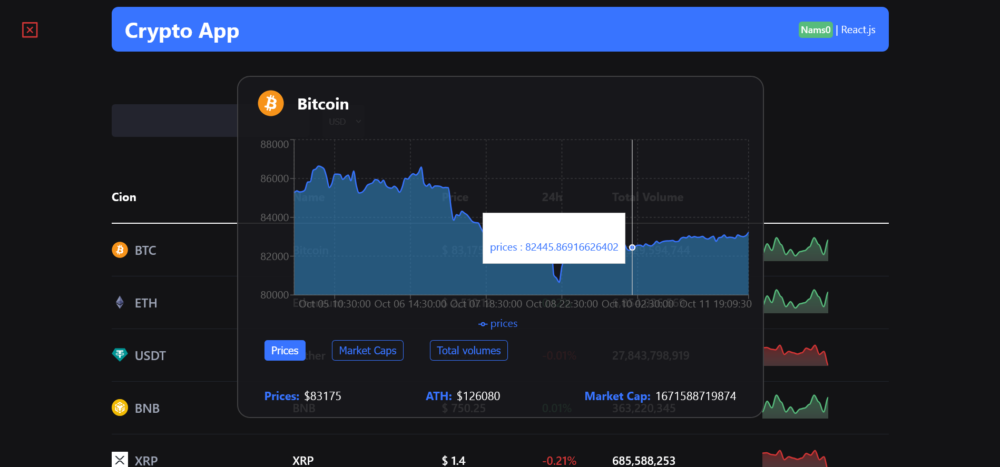
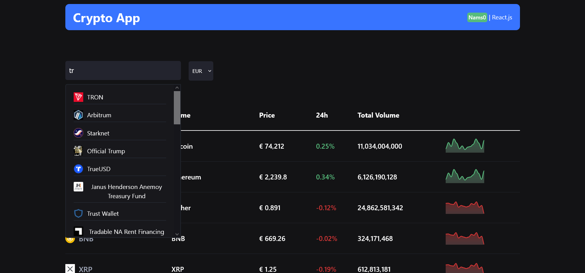

# 💹 Crypto Tracker Dashboard

A feature-rich cryptocurrency tracking application with interactive charts, real-time data, and a sleek dark-themed interface. Built with **React** and modern web technologies for optimal performance.

---

## 🔑 Features

- 📊 **Interactive Charts** – Detailed price history with Recharts integration (`AreaChart`)
- 🔍 **Smart Search** – Live coin search with thumbnail previews
- 🔄 **Multi-Currency Support** – USD, EUR, JPY with dynamic symbol rendering
- 📈 **Market Data** – Real-time prices, 24h changes, volumes, and ATH tracking
- 📱 **Responsive Design** – Fully mobile-friendly with adaptive components
- 🎨 **Dark UI** – Eye-friendly dark theme with vibrant accent colors

---

## 🧩 Component Highlights

- 🔁 **Dynamic Chart Modal** – Toggle between prices, market caps, and volumes
- 📄 **Smart Pagination** – Optimized 10-page navigation with quick jumps
- 📊 **Data-Rich Tables** – Sortable columns with visual trend indicators
- 🚀 **Performance Optimized** – Loading spinners and abort controllers for API calls

---

## 📸 Screenshots

### 🏠 Home Page

### 📈 Coin Details & Chart Modal

### 🔍 Live Search

---

## 🛠️ Tech Stack

| Category               | Technology                               |
| ---------------------- | ---------------------------------------- |
| **Framework**          | React.js (Functional Components + Hooks) |
| **Data Visualization** | Recharts                                 |
| **Styling**            | CSS Modules                              |
| **API Integration**    | CoinGecko / CoinMarketCap REST API       |
| **Icons**              | React Icons                              |

---
